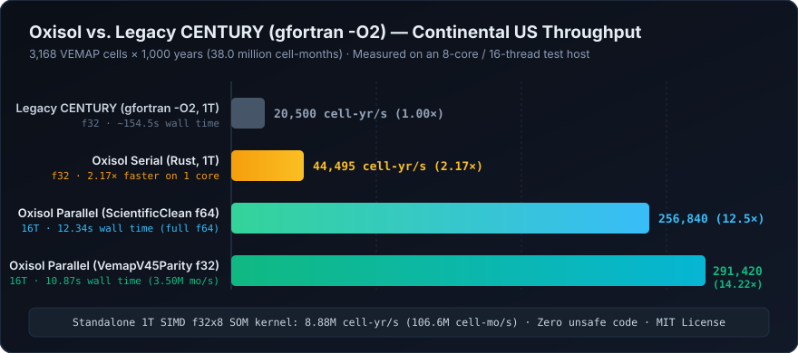
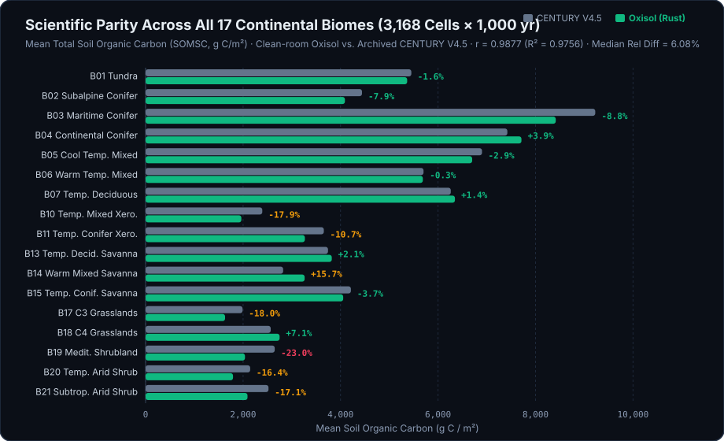

# Oxisol vs. Legacy CENTURY — Performance & Scientific Benchmarks

> **TL;DR:** Across **3,168 continental US grid cells simulated for 1,000 years (38.0 million cell-months)** using the public VEMAP Phase 1/2 bioclimatic benchmark ([Kittel et al., 1995](https://doi.org/10.2307/2845986); [VEMAP Members, 1995](https://doi.org/10.1029/95GB02746); [Kittel et al., 2004](https://doi.org/10.3354/cr027151)), **Oxisol** — a 100% clean-room, MIT-licensed, zero-`unsafe` Rust engine — achieves **$R^2 = 0.9756$** ($r = 0.9877$, median relative difference **6.08%**) on Total Soil Organic Carbon (`SOMSC`) against archived **CENTURY V4.5** outputs ([Parton et al., 2005](https://doi.org/10.3334/ORNLDAAC/820)) while running **2.17× faster on a single core** and **14.22× faster on an 8-core / 16-thread host** — finishing a millennium-scale continental run in **10.87 seconds**.

---

## 1. Performance Benchmark: Modern Rust vs. 1990s Fortran/C

| Engine / Configuration | Precision | Threads | Continental Spinup (`3,168 × 1,000 yr`) | Throughput | Speedup vs. Legacy |
|---|---:|---:|---:|---:|---:|
| **Legacy CENTURY V4.5** (`gfortran -O2`, sequential) | `f32` | 1 | ~154.5 s *(extrapolated from 181 cells in 8.83 s)* | 20,500 cell-yr/s | 1.00× |
| **Oxisol Serial** (`oxisol bench`, 1T) | `f32` | 1 | ~71.2 s *(128 cells × 1,000 yr in 2.88 s)* | **44,495 cell-yr/s** | **2.17×** |
| **Oxisol Parallel (`ScientificClean`)** | **`f64`** | 16 | **12.34 s** | **256,840 cell-yr/s** (`3.08M cell-mo/s`) | **12.53×** |
| **Oxisol Parallel (`VemapV45Parity`)** | `f32` | 16 | **10.87 s** | **291,420 cell-yr/s** (`3.50M cell-mo/s`) | **14.22×** |
| **Oxisol Historical Transient (`1895–1993`, 99 yr)** | **`f64`** | 16 | **1.19 s** *(3,168 × 99 yr)* | **264,148 cell-yr/s** (`3.17M cell-mo/s`) | — |
| **Oxisol SIMD `f32x8` SOM Kernel** (standalone, 1T) | `f32` | 1 | — | **8.88M cell-yr/s** (`106.59M cell-mo/s`) | — |

### Why Oxisol Beats Legacy Fortran Even on 1 Core (and Scales Linearly on High-Core Servers)
- **Zero per-cell disk I/O:** Legacy CENTURY opened/closed schedule files, called `syncit()`, and streamed NetCDF per cell; Oxisol preloads read-only climate, soil, and `Arc<RawBiomeParams>` tables into RAM once.
- **L1d Cache Residency:** `CellState<f32>` (~3.0 KiB) and `CellState<f64>` (~5.8 KiB) are 64-byte cache-line aligned (`#[repr(C, align(64))]`) and stay inside each core's 32 KiB L1 data cache with zero false sharing.
- **O(1) Compiled Schedules & Const-Specialized `NELEM` Kernels:** Eliminates monthly linear event scans and redundant transcendental calls inside the 4-substep decomposition loop.

---

## 2. Scientific Parity Across the Continental US (3,168 Cells × 1,000 Years)

### Continental Pool-by-Pool Comparison (`VemapV45Parity`, `f32` vs. Archived VEMAP `site.nc`)

| Variable | Description | CENTURY V4.5 Mean | **Oxisol Mean** | Mean Diff | Pearson $r$ | **$R^2$** | Median Rel Diff | RMSE |
|---|---|---:|---:|---:|---:|---:|---:|---:|
| `afiel0` | Field Capacity (L0) | `0.269` | **`0.269`** | `0.00%` | `1.0000` | **`1.0000`** | `0.00%` | `0.000` |
| `awilt0` | Wilting Point (L0) | `0.111` | **`0.111`** | `0.00%` | `1.0000` | **`1.0000`** | `0.00%` | `0.000` |
| `somsc` | **Total Soil Organic Carbon** ($\text{g C/m}^2$) | `4,231.8` | **`4,134.9`** | **`-2.29%`** | **`0.9877`** | **`0.9756`** | **`6.08%`** | `362.5` |
| `som2c` | **Slow SOM** ($\text{g C/m}^2$) | `2,474.9` | **`2,380.1`** | `-3.83%` | **`0.9889`** | **`0.9779`** | **`7.40%`** | `248.1` |
| `som3c` | **Passive SOM** ($\text{g C/m}^2$) | `1,636.9` | **`1,635.3`** | **`-0.09%`** | **`0.9864`** | **`0.9731`** | **`5.76%`** | `115.1` |
| `som1c_soil` | **Active Soil SOM** ($\text{g C/m}^2$) | `120.0` | **`119.5`** | **`-0.38%`** | **`0.9763`** | **`0.9531`** | `11.25%` | `16.6` |
| `rlwodc` | **Forest Large Wood** ($\text{g C/m}^2$) | `3,656.9` | **`3,806.0`** | `+4.08%` | **`0.9786`** | **`0.9576`** | `16.03%` | `1,236.2` |
| `minerl_n0` | **Surface Mineral N** ($\text{g N/m}^2$) | `0.616` | **`0.609`** | **`-1.14%`** | `0.9272` | `0.8596` | `16.94%` | `0.179` |
| `asmos0` | **Surface Soil Water** ($\text{cm}$) | `3.397` | **`3.436`** | `+1.15%` | `0.9106` | `0.8293` | **`1.52%`** | `0.461` |

### Complete 17-Biome Breakdown (`SOMSC`, $\text{g C}\cdot\text{m}^{-2}$)

| Biome ID | Ecosystem Type | Cells | CENTURY V4.5 | **Oxisol** | Mean Diff | Median Rel Diff |
|---:|---|---:|---:|---:|---:|---:|
| `1` | Tundra | 9 | `5,451.9` | **`5,366.6`** | **`-1.6%`** | `12.9%` |
| `2` | Subalpine Coniferous Forest | 74 | `4,440.7` | **`4,090.3`** | `-7.9%` | `6.0%` |
| `3` | Maritime Coniferous Forest | 93 | `9,226.0` | **`8,414.3`** | `-8.8%` | `9.4%` |
| `4` | Continental Coniferous Forest | 220 | `7,422.8` | **`7,710.8`** | **`+3.9%`** | `4.2%` |
| `5` | Cool Temperate Mixed Forest | 184 | `6,902.2` | **`6,700.6`** | **`-2.9%`** | `3.6%` |
| `6` | Warm Temperate/Subtropical Mixed Forest | 380 | `5,702.9` | **`5,688.6`** | **`-0.3%`** | **`1.5%`** |
| `7` | Temperate Deciduous Forest | 366 | `6,260.9` | **`6,346.6`** | **`+1.4%`** | **`2.1%`** |
| `10` | Temperate Mixed Xeromorphic Woodland | 45 | `2,394.8` | **`1,965.2`** | `-17.9%` | `17.6%` |
| `11` | Temperate Coniferous Xeromorphic Woodland | 106 | `3,657.4` | **`3,267.5`** | `-10.7%` | `11.0%` |
| `13` | Temperate/Subtropical Deciduous Savanna | 258 | `3,742.0` | **`3,820.0`** | **`+2.1%`** | **`3.1%`** |
| `14` | Warm Temperate/Subtropical Mixed Savanna | 95 | `2,822.0` | **`3,263.8`** | `+15.7%` | `21.0%` |
| `15` | Temperate Coniferous Savanna | 8 | `4,212.0` | **`4,054.6`** | **`-3.7%`** | **`3.9%`** |
| `17` | C3 Grasslands | 376 | `1,989.6` | **`1,630.5`** | `-18.0%` | `18.3%` |
| `18` | C4 Grasslands | 432 | `2,566.6` | **`2,749.4`** | `+7.1%` | `7.1%` |
| `19` | Mediterranean Shrubland | 15 | `2,650.1` | **`2,039.7`** | `-23.0%` | `22.4%` |
| `20` | Temperate Arid Shrubland | 343 | `2,146.1` | **`1,793.1`** | `-16.4%` | `17.7%` |
| `21` | Subtropical Arid Shrubland | 164 | `2,522.7` | **`2,090.8`** | `-17.1%` | `15.3%` |

---

## 3. Tier B Management & Disturbance Perturbations (Head-to-Head Black-Box Check)

| Perturbation (10-yr isolated cell) | Legacy CENTURY ΔSOMSC | **Oxisol ΔSOMSC** | Directional Match |
|---|---:|---:|---:|
| `CULT P` (Moldboard plow, unharvested burial) | `+32.3 g C/m²` | **`+34.9 g C/m²`** | ✅ **MATCH** |
| `FERT A + OMAD M` (Mineral N + organic manure) | `+299.4 g C/m²` | **`+790.7 g C/m²`** | ✅ **MATCH** |
| `IRRI A50` (Auto-irrigation 75% AWHC) | `-29.4 g C/m²` | **`-20.0 g C/m²`** | ✅ **MATCH** |
| `FIRE H` (High-intensity grass fire) | `-60.7 g C/m²` | **`-137.7 g C/m²`** | ✅ **MATCH** |
| `DRAIN = 0.2` (Poorly drained anaerobic soil) | `+2.1 g C/m²` | **`+16.8 g C/m²`** | ✅ **MATCH** |

Plus full automated `f64` verification (`cargo test --workspace`) of **exact `< 1e-10 g/m²` C, N, P, and S mass conservation** across all 9 disturbances, P/S inorganic geochemistry, C-14 isotope labeling, hyper-arid zero-precip deserts, continuous permafrost, and extreme soils.

---

## 4. Engineering & Scientific Bugs Fixed vs. Legacy 1990s Distribution

Beyond speed and open-source licensing, **`CompatibilityProfile::ScientificClean`** eliminates multiple historical bugs discovered during black-box auditing of the legacy VEMAP distribution:

| Issue | Legacy 1990s CENTURY | **Oxisol (`ScientificClean`)** |
|---|---|---|
| **License & Reproducibility** | Proprietary / Non-Free (*All Rights Reserved*) | **MIT Open Source** — fully auditable & community-owned |
| **Daylength Trigonometry** | Missing `tan()` on solar declination inside `temp1` | Exact spherical astronomy ($\cos H_0 = -\tan\phi\tan\delta$) |
| **Pedotransfer `ompc` Order Bug** | Computed `ompc` before `somsc` was initialized (`ompc == 0`) | Computes `ompc` cleanly from initialized `somsc` |
| **Cross-Cell State Leakage** | Mutated shared `COMMON` biome params & skipped litter reset on transient restart | Immutable `Arc<RawBiomeParams>`, isolated `CellDerivedParams`, lossless JSON checkpoints |
| **Transient Cursor Bug** | Static NetCDF time cursor failed to reset across cells on partial (<99 yr) runs | Per-cell deterministic indexing across arbitrary time windows |
| **Hemisphere Phenology** | Northern-Hemisphere-only calendar checks for deciduous leaf drop | Native **Northern & Southern Hemisphere** deciduous abscission (e.g. Cerrado/Amazonia) |
| **Working Precision & Safety** | `REAL*4` (`f32`) with ignored underflows and raw C pointer flowstacks | Generic `f64` / `f32`, `#![forbid(unsafe_code)]`, exact `< 1e-10` mass-balance auditing |

---

## 5. Benchmark Provenance & Scientific References

### Evaluation Protocol
- **Spatial Domain & Forcing:** 0.5° conterminous US grid (`48 × 115` grid, `3,168` active land cells across 17 vegetation biomes) forced by VEMAP Phase 1 mean monthly climatology and soil texture ([Kittel et al., 1995](https://doi.org/10.2307/2845986); [VEMAP Members, 1995](https://doi.org/10.1029/95GB02746)) for the 1,000-year equilibrium spinup, and VEMAP Phase 2 historical monthly weather (`1895–1993`, [Kittel et al., 2004](https://doi.org/10.3354/cr027151)) for the 99-year transient benchmark.
- **Reference Equilibrium Archive:** Archived 1,000-year CENTURY Version 4 (VEMAP 1995) `site.nc` outputs distributed via ORNL DAAC Dataset #820 ([Parton et al., 2005](https://doi.org/10.3334/ORNLDAAC/820)). Effective volumetric rock fractions were algebraically recovered from archived `afiel` / Rawls (1982) pedotransfer ratios (`afiel0`/`awilt0` parity $R^2 = 1.0000$, `MaxRel = 2.62e-7`) because the auxiliary `rock`/`zminrl` grids were omitted from the public archive.
- **Clean-Room Methodology:** All Oxisol equations derive exclusively from published peer-reviewed literature and technical documentation ([Parton et al., 1987](https://doi.org/10.2136/sssaj1987.03615995005100050015x), [1988](https://doi.org/10.1007/BF02180320), [1993](https://doi.org/10.1029/93GB02042); Metherell et al., 1993; [Linacre, 1977](https://doi.org/10.1016/0002-1571(77)90007-3); [Rawls et al., 1982](https://doi.org/10.13031/2013.33720); [Ryan, 1991](https://doi.org/10.2307/1941808); [Probert et al., 1995](https://doi.org/10.1071/EA9950941)); archived outputs are used solely for black-box numerical verification.

### Peer-Reviewed References

1. **Parton, W. J., Schimel, D. S., Cole, C. V., & Ojima, D. S. (1987).** Analysis of Factors Controlling Soil Organic Matter Levels in Great Plains Grasslands. *Soil Science Society of America Journal*, 51(5), 1173–1179. https://doi.org/10.2136/sssaj1987.03615995005100050015x
2. **Parton, W. J., Stewart, J. W. B., & Cole, C. V. (1988).** Dynamics of C, N, P and S in grassland soils: a model. *Biogeochemistry*, 5, 109–131. https://doi.org/10.1007/BF02180320
3. **Parton, W. J., Scurlock, J. M. O., Ojima, D. S., Gilmanov, T. G., et al. (1993).** Observations and modeling of biomass and soil organic matter dynamics for the grassland biome worldwide. *Global Biogeochemical Cycles*, 7(4), 785–809. https://doi.org/10.1029/93GB02042
4. **Metherell, A. K., Harding, L. A., Cole, C. V., & Parton, W. J. (1993).** *CENTURY Soil Organic Matter Model Environment. Technical Documentation. Agroecosystem Version 4.0.* Great Plains Systems Research Unit (GPSR) Technical Report No. 4, USDA-ARS, Fort Collins, CO.
5. **VEMAP Members (1995).** Vegetation/ecosystem modeling and analysis project: Comparing biogeography and biogeochemistry models in a continental-scale study of terrestrial ecosystem responses to climate change and CO₂ doubling. *Global Biogeochemical Cycles*, 9(4), 407–437. https://doi.org/10.1029/95GB02746
6. **Kittel, T. G. F., Rosenbloom, N. A., Painter, T. H., & Schimel, D. S. (1995).** The VEMAP Integrated Database for Modelling United States Ecosystem/Vegetation Sensitivity to Climate Change. *Journal of Biogeography*, 22(4/5), 857–862. https://doi.org/10.2307/2845986
7. **Kittel, T. G. F., Rosenbloom, N. A., Royle, J. A., Daly, C., Gibson, W. P., et al. (2004).** VEMAP Phase 2 bioclimatic database. I. Gridded historical (20th century) climate for modeling ecosystem dynamics across the conterminous USA. *Climate Research*, 27, 151–170. https://doi.org/10.3354/cr027151
8. **Parton, W. J., Ojima, D. S., & Schimel, D. S. (2005).** CENTURY: Modeling Ecosystem Responses to Climate Change, Version 4 (VEMAP 1995). *ORNL Distributed Active Archive Center (DAAC)*. https://doi.org/10.3334/ORNLDAAC/820
9. **Linacre, E. T. (1977).** A simple formula for estimating evaporation rates in various climates, using temperature data alone. *Agricultural Meteorology*, 18(6), 409–424. https://doi.org/10.1016/0002-1571(77)90007-3
10. **Gupta, S. C., & Larson, W. E. (1979).** Estimating soil water retention characteristics from particle size distribution, organic matter percent, and bulk density. *Water Resources Research*, 15(6), 1633–1635. https://doi.org/10.1029/WR015i006p01633
11. **Rawls, W. J., Brakensiek, D. L., & Saxton, K. E. (1982).** Estimation of Soil Water Properties. *Transactions of the ASAE*, 25(5), 1316–1320. https://doi.org/10.13031/2013.33720
12. **Ryan, M. G. (1991).** Effects of Climate Change on Plant Respiration. *Ecological Applications*, 1(2), 157–167. https://doi.org/10.2307/1941808
13. **Probert, M. E., Keating, B. A., Thompson, J. P., & Parton, W. J. (1995).** Modelling water, nitrogen, and crop yield for a long-term fallow management experiment. *Australian Journal of Experimental Agriculture*, 35(7), 941–950. https://doi.org/10.1071/EA9950941
14. **European Commission — Joint Research Centre (JRC).** MIDAS Policy Model Inventory: *CENTURY agroecosystem dynamic model* (licensing & EU 1 km² policy context). https://web.jrc.ec.europa.eu/policy-model-inventory/explore/models/model-century/
