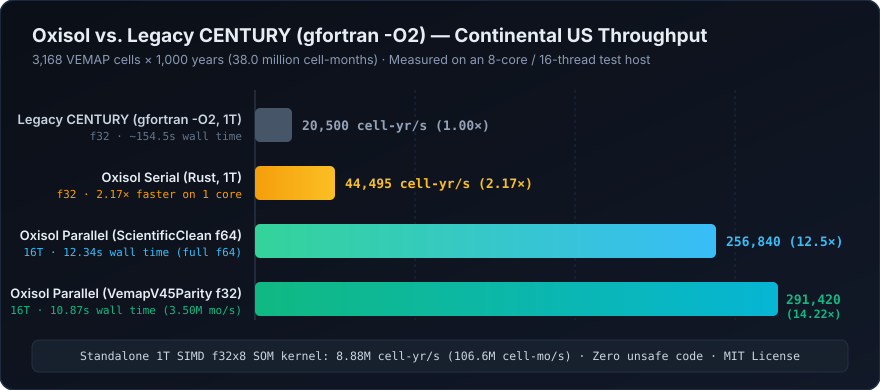
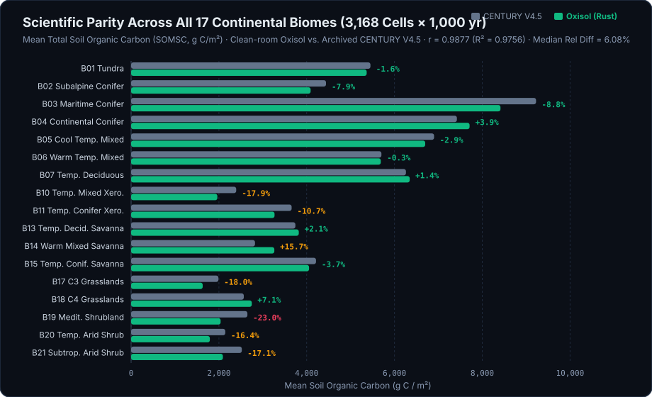

# Oxisol

**An open-source, high-speed soil carbon and ecosystem simulator — built for modern climate, agriculture, and landscape science.**

[](LICENSE)
[](https://www.rust-lang.org/)
[](https://vieiramesquita.github.io/oxisol/)

**[Documentation Portal](https://vieiramesquita.github.io/oxisol/) · [Spatial Raster Examples](examples/spatial_raster/README.md) · [Glossary & Acronyms](https://vieiramesquita.github.io/oxisol/glossary.html) · [Benchmarks & Validation](BENCHMARKS.md) · [API Reference](https://vieiramesquita.github.io/oxisol/api/oxisol_core/index.html)**

---

## Why Oxisol?

Soils hold more organic carbon than the atmosphere and all living vegetation combined ([Scharlemann et al., 2014](https://doi.org/10.4155/cmt.13.77)). Understanding how that carbon responds to warming, rainfall shifts, grazing, fire, deforestation, or regenerative agriculture is central to climate science and land-use policy.

In the late 1980s, William J. Parton and colleagues pioneered the **CENTURY** model ([Parton et al., 1987](https://doi.org/10.2136/sssaj1987.03615995005100050015x); [Parton et al., 1993](https://doi.org/10.1029/93GB02042)) — a landmark framework that became one of the most cited tools in Earth system science. Yet nearly forty years later, while the science was always open in peer-reviewed journals, the original software remained locked inside closed, 1990s single-threaded code.

**Foundational climate and soil science belongs in the open.**

Named after **Oxisols** (*Latossolos*) — the deeply weathered, iron-rich tropical soils of the Amazon and Cerrado whose rust-red color echoes the **Rust** language — **Oxisol** is an independent, open-source (MIT) *CENTURY-like* ecosystem engine built from scratch from the published scientific literature.

---

## What You Can Do

- **Simulate Soil Carbon & Ecosystem Health**
  Track carbon, nitrogen, phosphorus, and sulfur across pastures, croplands, savannas, and forests in both the **Northern and Southern Hemispheres**. Report soil organic carbon in **`Mg C/ha`** (or `g C/m²`) across classic topsoil (`0–20 cm`), IPCC standard (`0–30 cm`), and deep-root (`0–100 cm`) soil profiles, and test management practices such as grazing, fire, fertilization, tillage, irrigation, organic amendments, and harvest.
- **Explore Interactively in Your Browser (*Oxisol Studio*)**
  Launch a built-in visual workbench in **English or Portuguese (PT-BR)** with zero extra dependencies. Start from calibrated ecosystem presets — including Brazilian Cerrado tropical pasture (*Urochloa* / *Panicum*) — adjust climate, soil texture, pH, and latitude with live interactive controls, and inspect results immediately.
- **Map Real Landscapes with Satellite Rasters**
  Run regional carbon simulations directly from standard GeoTIFF maps — with built-in support for **MapBiomas Brasil (Collection 11)** and **ESA WorldCover** land-use classes alongside climate and soil rasters. Filter specific classes (such as *Pasture only*), choose your modeling resolution, and export GIS-ready soil carbon maps. Works smoothly on an everyday laptop and scales automatically to high-performance servers.
- **Fast, Self-Contained & Reproducible**
  Ships as a single self-contained program with no external C, Fortran, or GDAL libraries to install, runs up to **14× faster** than legacy 1990s implementations, and verifies exact mass conservation at every step.

---

## Quick Start

> Requires [Rust](https://rustup.rs/) (`1.80+`). No external C, Fortran, or GDAL libraries needed.

### 1. Open the visual interface (*Oxisol Studio*)

```bash
cargo run --release -p oxisol-cli -- serve --port 8080
```

Then open **`http://127.0.0.1:8080`** in your browser to explore presets, run scenarios, upload GeoTIFF rasters, or browse the built-in bilingual glossary.

### 2. Run a spatial raster simulation (GeoTIFF)

Want to map soil carbon across a pasture or watershed using your own satellite and climate maps? Start with our ready-to-run tutorial, synthetic sample data, Python script, and Google Earth Engine export template:

👉 **[Spatial Raster Examples & Tutorial (`examples/spatial_raster/`)](examples/spatial_raster/README.md)**

---

## Validated Science, Modern Speed

Oxisol was benchmarked head-to-head against archived continental-scale **VEMAP** simulations covering **3,168 locations across 1,000 years** (38 million cell-months):

- **Continental Accuracy:** Reproduces equilibrium soil organic carbon across 17 biomes at **$R^2 = 0.976$** ($r = 0.988$, median difference **6.1%**), matching active, slow, and passive soil pools as well as forest wood and soil moisture — while fixing known 1990s bugs and adding native Southern Hemisphere seasonality.
- **Modern Performance:** Runs **2.2× faster** on a single core and **14.2× faster** on a multi-core workstation (completing 3,168 locations × 1,000 years in **under 11 seconds**), and scales cleanly to high-performance servers.





> Full validation tables, 17-biome breakdowns, and hardware benchmarks are available in **[`BENCHMARKS.md`](BENCHMARKS.md)**.

---

## Where to Go Next

| What are you looking for? | Start here |
|---|---|
| **Plain-language definitions of acronyms & model terms** | [Glossary & Acronyms Dictionary](https://vieiramesquita.github.io/oxisol/glossary.html) |
| **Step-by-step GeoTIFF / MapBiomas / GEE workflows** | [Spatial Raster Examples](examples/spatial_raster/README.md) |
| **User guide, equations, CLI flags & REST API** | [Documentation Portal (`mdBook`)](https://vieiramesquita.github.io/oxisol/) |
| **Detailed scientific validation & speed benchmarks** | [Benchmarks & Parity Report](BENCHMARKS.md) |
| **Rust library documentation** | [Rust API Reference (`rustdoc`)](https://vieiramesquita.github.io/oxisol/api/oxisol_core/index.html) |

<details>
<summary><strong>For Developers: Workspace Structure & Testing</strong></summary>

```text
oxisol/
├── crates/
│   ├── oxisol-core/   # Core biogeochemical engine (100% safe Rust)
│   ├── oxisol-io/     # Pure-Rust GeoTIFF/COG, NetCDF, legacy format & checkpoint I/O
│   ├── oxisol-grid/   # Multi-core parallel runner & SIMD benchmarks
│   ├── oxisol-web/    # Embedded Oxisol Studio web app & REST API
│   └── oxisol-cli/    # Command-line interface (`serve`, `raster`, `run`, `validate`, `bench`)
├── examples/          # Ready-to-run spatial raster workflows & GEE export scripts
└── docs/              # Documentation portal (mdBook) & mathematical specification
```

Run the full test suite:

```bash
cargo test --workspace
```

</details>

---

## Authorship

- **Author:** [Vinícius Mesquita](https://github.com/vieiramesquita) (`@vieiramesquita`)
- **AI Co-Author:** Antigravity (Google DeepMind)

---

## Scientific Foundations & License

Oxisol is grounded in peer-reviewed soil biogeochemistry and ecosystem modeling literature, including [Parton et al. (1987)](https://doi.org/10.2136/sssaj1987.03615995005100050015x), [Parton et al. (1988)](https://doi.org/10.1007/BF02180320), [Parton et al. (1993)](https://doi.org/10.1029/93GB02042), [VEMAP Members (1995)](https://doi.org/10.1029/95GB02746), [Jobbágy & Jackson (2000)](https://doi.org/10.1890/1051-0761(2000)010[0423:TVDOSO]2.0.CO;2), and [Scharlemann et al. (2014)](https://doi.org/10.4155/cmt.13.77).

<details>
<summary><strong>Full Scientific Reference List</strong></summary>

- **Scharlemann, J. P. W., Tanner, E. V. J., Hiederer, R., & Kapos, V. (2014).** Global soil carbon: understanding and managing the largest terrestrial carbon pool. *Carbon Management*, 5(1), 81–91. https://doi.org/10.4155/cmt.13.77
- **Parton, W. J., Schimel, D. S., Cole, C. V., & Ojima, D. S. (1987).** Analysis of Factors Controlling Soil Organic Matter Levels in Great Plains Grasslands. *Soil Science Society of America Journal*, 51(5), 1173–1179. https://doi.org/10.2136/sssaj1987.03615995005100050015x
- **Parton, W. J., Stewart, J. W. B., & Cole, C. V. (1988).** Dynamics of C, N, P and S in grassland soils: a model. *Biogeochemistry*, 5, 109–131. https://doi.org/10.1007/BF02180320
- **Parton, W. J., Scurlock, J. M. O., Ojima, D. S., Gilmanov, T. G., et al. (1993).** Observations and modeling of biomass and soil organic matter dynamics for the grassland biome worldwide. *Global Biogeochemical Cycles*, 7(4), 785–809. https://doi.org/10.1029/93GB02042
- **Metherell, A. K., Harding, L. A., Cole, C. V., & Parton, W. J. (1993).** *CENTURY Soil Organic Matter Model Environment. Technical Documentation. Agroecosystem Version 4.0.* Great Plains Systems Research Unit (GPSR) Technical Report No. 4, USDA-ARS, Fort Collins, CO.
- **VEMAP Members (1995).** Vegetation/ecosystem modeling and analysis project: Comparing biogeography and biogeochemistry models in a continental-scale study of terrestrial ecosystem responses to climate change and CO₂ doubling. *Global Biogeochemical Cycles*, 9(4), 407–437. https://doi.org/10.1029/95GB02746
- **Kittel, T. G. F., Rosenbloom, N. A., Painter, T. H., & Schimel, D. S. (1995).** The VEMAP Integrated Database for Modelling United States Ecosystem/Vegetation Sensitivity to Climate Change. *Journal of Biogeography*, 22(4/5), 857–862. https://doi.org/10.2307/2845986
- **Kittel, T. G. F., Rosenbloom, N. A., Royle, J. A., Daly, C., Gibson, W. P., et al. (2004).** VEMAP Phase 2 bioclimatic database. I. Gridded historical (20th century) climate for modeling ecosystem dynamics across the conterminous USA. *Climate Research*, 27, 151–170. https://doi.org/10.3354/cr027151
- **Parton, W. J., Ojima, D. S., & Schimel, D. S. (2005).** CENTURY: Modeling Ecosystem Responses to Climate Change, Version 4 (VEMAP 1995). *ORNL Distributed Active Archive Center (DAAC)*. https://doi.org/10.3334/ORNLDAAC/820
- **Jobbágy, E. G., & Jackson, R. B. (2000).** The vertical distribution of soil organic carbon and its relation to climate and vegetation. *Ecological Applications*, 10(2), 423–436. https://doi.org/10.1890/1051-0761(2000)010[0423:TVDOSO]2.0.CO;2
- **Linacre, E. T. (1977).** A simple formula for estimating evaporation rates in various climates, using temperature data alone. *Agricultural Meteorology*, 18(6), 409–424. https://doi.org/10.1016/0002-1571(77)90007-3
- **Gupta, S. C., & Larson, W. E. (1979).** Estimating soil water retention characteristics from particle size distribution, organic matter percent, and bulk density. *Water Resources Research*, 15(6), 1633–1635. https://doi.org/10.1029/WR015i006p01633
- **Rawls, W. J., Brakensiek, D. L., & Saxton, K. E. (1982).** Estimation of Soil Water Properties. *Transactions of the ASAE*, 25(5), 1316–1320. https://doi.org/10.13031/2013.33720
- **Ryan, M. G. (1991).** Effects of Climate Change on Plant Respiration. *Ecological Applications*, 1(2), 157–167. https://doi.org/10.2307/1941808
- **Probert, M. E., Keating, B. A., Thompson, J. P., & Parton, W. J. (1995).** Modelling water, nitrogen, and crop yield for a long-term fallow management experiment. *Australian Journal of Experimental Agriculture*, 35(7), 941–950. https://doi.org/10.1071/EA9950941
- **European Commission — Joint Research Centre (JRC).** MIDAS Policy Model Inventory: *CENTURY agroecosystem dynamic model*. https://web.jrc.ec.europa.eu/policy-model-inventory/explore/models/model-century/

</details>

Released under the **[MIT License](LICENSE)**.
