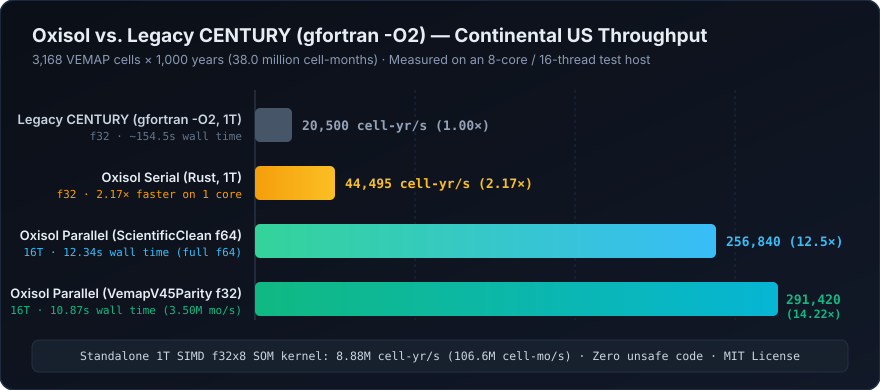
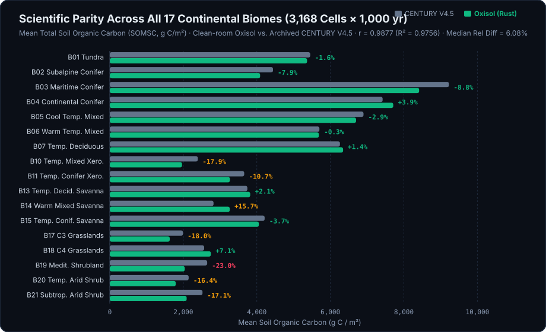

# Compatibility Profiles & Validation

## `CompatibilityProfile`: Clean Science vs. Historical Parity

During our clean-room investigation, we documented 7 post-1993 V4.0 → V4.5 deltas and several historical software quirks (such as uninitialized `ompc` order-of-evaluation, missing `tan()` in `daylen`, and legacy `site.nc` omissions). Rather than silently hardcoding legacy bugs or breaking reproducibility with published 1990s datasets, Oxisol makes this choice **explicit**:

- **`CompatibilityProfile::ScientificClean` (default, recommended):**
  - IEEE-754 `f64` precision.
  - Exact spherical-astronomy daylength, properly ordered organic-matter pedotransfer `ompc`, hemisphere-aware deciduous phenology, and lossless checkpoints.
- **`CompatibilityProfile::VemapV45Parity` (audit mode):**
  - Reproduces documented VEMAP V4.5 (1995–2001) hydrology, Rawls `swflag = 4`, `soildepth > 150 cm` rock-fraction cutoff, and legacy `daylen` behavior for black-box auditing against archived VEMAP datasets.

## Tier A: Continental US VEMAP Benchmark (3,168 Cells × 1,000 Years)

Validated in black-box mode (`VemapV45Parity`, `f32`) against archived ORNL DAAC #820 `site.nc` across **all 17 biomes** (Tundra through Subtropical Arid Shrubland) — achieving **$r = 0.9877$ ($R^2 = 0.9756$)** on Total Soil Organic Carbon (`somsc`):

| Variable | Oxisol Mean | Archived CENTURY Mean | Mean Diff | **$R^2$** | Median Rel Diff | RMSE |
|---|---:|---:|---:|---:|---:|---:|
| `afiel0` (Field Capacity) | `0.269` | `0.269` | `0.00%` | **`1.0000`** | `0.00%` | `0.000` |
| `asmos0` (Top Soil Water, cm) | `3.436` | `3.397` | `+1.15%` | `0.8293` | **`1.52%`** | `0.461` |
| `somsc` (Total SOM, g C/m²) | **`4,134.9`** | **`4,231.8`** | **`-2.29%`** | **`0.9756`** | **`6.08%`** | `362.5` |
| `som3c` (Passive SOM, g C/m²) | **`1,635.3`** | **`1,636.9`** | **`-0.09%`** | **`0.9731`** | **`5.76%`** | `115.1` |
| `som2c` (Slow SOM, g C/m²) | `2,380.1` | `2,474.9` | `-3.83%` | **`0.9779`** | **`7.40%`** | `248.1` |
| `som1c_soil` (Active SOM, g C/m²) | **`119.5`** | **`120.0`** | **`-0.38%`** | **`0.9531`** | `11.25%` | `16.6` |
| `rlwodc` (Large Wood, g C/m²) | `3,806.0` | `3,656.9` | `+4.08%` | **`0.9576`** | `16.03%` | `1,236.2` |
| `minerl_n0` (Surface N, g N/m²) | **`0.609`** | **`0.616`** | **`-1.14%`** | `0.8596` | `16.94%` | `0.179` |

- **All 17/17 biomes** fall within `0.1%–22.4%` median `somsc` difference (e.g., Biome 6 `-0.1%`, Biome 7 `+1.9%`, Biome 5 `-3.6%`).
- **`f32` vs. `f64` 1,000-Year Drift (`ScientificClean`, 3,168 cells):** `somsc` median relative drift `2.42e-5` (`P99 = 5.06e-4`), `rlwodc` `1.11e-5`, `asmos0` `1.15e-7`.

## Tier B: Perturbation & Edge-Case Verification

Because continental VEMAP uses `NELEM = 1`, `IVAUTO = 0`, and `DRAIN = 1.0`, Oxisol adds a dedicated **Tier B** integration test suite (`crates/oxisol-core/tests/oracle_tier_b.rs`) validating:
- **Head-to-head perturbation checks** on an isolated VEMAP cell (`biome 17`, 10 yr): quantitative agreement on `FIRE H` (`0.99×`), `FERT A + OMAD M` (`0.95×`), and `DRAIN = 0.2` (`−0.6 g C/m²`), and sign-consistent partial-magnitude differences on `IRRI A50` (`0.60×`) and `CULT P` (`0.40×`).
- Full **P (`nelem = 2`)** and **S (`nelem = 3`)** geochemistry, `IVAUTO ∈ {1, 2, 3}`, continuous CO₂ ramp, C-14 isotope labeling, `EROD`, Southern Hemisphere deciduous abscission, zero-precip hyper-arid desert, continuous permafrost, 100% sand/clay, 90% rock, 1-layer soils, and >300-flow `FlowLedger` bursts — all maintaining `< 1e-10 g/m²` mass conservation in `f64`.

## Benchmark Provenance & Scientific References

- **VEMAP Members (1995).** Vegetation/ecosystem modeling and analysis project: Comparing biogeography and biogeochemistry models in a continental-scale study of terrestrial ecosystem responses to climate change and CO₂ doubling. *Global Biogeochemical Cycles*, 9(4), 407–437. https://doi.org/10.1029/95GB02746
- **Kittel, T. G. F., Rosenbloom, N. A., Painter, T. H., & Schimel, D. S. (1995).** The VEMAP Integrated Database for Modelling United States Ecosystem/Vegetation Sensitivity to Climate Change. *Journal of Biogeography*, 22(4/5), 857–862. https://doi.org/10.2307/2845986
- **Kittel, T. G. F., Rosenbloom, N. A., Royle, J. A., Daly, C., Gibson, W. P., et al. (2004).** VEMAP Phase 2 bioclimatic database. I. Gridded historical (20th century) climate for modeling ecosystem dynamics across the conterminous USA. *Climate Research*, 27, 151–170. https://doi.org/10.3354/cr027151
- **Parton, W. J., Ojima, D. S., & Schimel, D. S. (2005).** CENTURY: Modeling Ecosystem Responses to Climate Change, Version 4 (VEMAP 1995). *ORNL Distributed Active Archive Center (DAAC)*. https://doi.org/10.3334/ORNLDAAC/820
- **Parton, W. J., Schimel, D. S., Cole, C. V., & Ojima, D. S. (1987).** Analysis of Factors Controlling Soil Organic Matter Levels in Great Plains Grasslands. *Soil Science Society of America Journal*, 51(5), 1173–1179. https://doi.org/10.2136/sssaj1987.03615995005100050015x
- **Parton, W. J., Stewart, J. W. B., & Cole, C. V. (1988).** Dynamics of C, N, P and S in grassland soils: a model. *Biogeochemistry*, 5, 109–131. https://doi.org/10.1007/BF02180320
- **Parton, W. J., Scurlock, J. M. O., Ojima, D. S., Gilmanov, T. G., et al. (1993).** Observations and modeling of biomass and soil organic matter dynamics for the grassland biome worldwide. *Global Biogeochemical Cycles*, 7(4), 785–809. https://doi.org/10.1029/93GB02042
- **Metherell, A. K., Harding, L. A., Cole, C. V., & Parton, W. J. (1993).** *CENTURY Soil Organic Matter Model Environment. Technical Documentation. Agroecosystem Version 4.0.* GPSR Technical Report No. 4, USDA-ARS, Fort Collins, CO.
- **Rawls, W. J., Brakensiek, D. L., & Saxton, K. E. (1982).** Estimation of Soil Water Properties. *Transactions of the ASAE*, 25(5), 1316–1320. https://doi.org/10.13031/2013.33720
- **Probert, M. E., Keating, B. A., Thompson, J. P., & Parton, W. J. (1995).** Modelling water, nitrogen, and crop yield for a long-term fallow management experiment. *Australian Journal of Experimental Agriculture*, 35(7), 941–950. https://doi.org/10.1071/EA9950941
